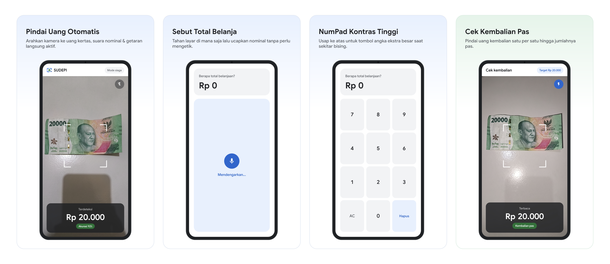

<p align="center">
  
</p>

<p align="center">
  Aplikasi Android untuk mendeteksi uang kertas Rupiah dan memverifikasi uang kembalian bagi penyandang tunanetra, berbasis visi komputer dan berjalan tanpa koneksi internet.
</p>

<p align="center">
  <a href="https://github.com/fajarmadn/SUDEPI/releases/latest">
    
  </a>
  
  
  
  <a href="./LICENSE">
    
  </a>
</p>

---

## Tentang SUDEPI

SUDEPI (Suara Deteksi Rupiah) adalah aplikasi Android yang membantu penyandang tunanetra dan low vision mengenali tujuh pecahan uang kertas Rupiah Tahun Emisi 2016 dan 2022 (Rp1.000 sampai Rp100.000) serta memeriksa uang kembalian belanja secara bertahap. Navigasi utamanya berbasis gestur pada layar penuh, dilengkapi papan angka cadangan serta panduan suara dan getaran.

Deteksi uang (YOLO26n dengan ONNX Runtime) dan umpan balik getaran dieksekusi langsung di perangkat, sedangkan masukan serta panduan suara memanfaatkan layanan pengenalan dan sintesis suara Bahasa Indonesia bawaan sistem Android. Aplikasi tidak meminta izin internet (`INTERNET`), tidak menampilkan iklan, dan tidak mengirim gambar kamera maupun rekaman suara ke server mana pun.

<p align="center">
  
</p>

---

## Unduh Aplikasi

Berkas instalasi (.apk) tersedia di halaman [GitHub Releases](https://github.com/fajarmadn/SUDEPI/releases/latest). Pilih sesuai arsitektur perangkat Android Anda.

| Paket Instalasi | Perangkat yang Didukung | Ukuran | Tautan Unduh |
| :--- | :--- | :---: | :---: |
| `SUDEPI-arm64-v8a.apk` (direkomendasikan) | Sebagian besar ponsel Android 64-bit (rilis sekitar 2018 ke atas) | ~45,5 MB | [Unduh 64-bit](https://github.com/fajarmadn/SUDEPI/releases/latest/download/SUDEPI-arm64-v8a.apk) |
| `SUDEPI-armeabi-v7a.apk` | Ponsel Android 32-bit atau kelas entri (minimal Android 7.0 Nougat) | ~37,8 MB | [Unduh 32-bit](https://github.com/fajarmadn/SUDEPI/releases/latest/download/SUDEPI-armeabi-v7a.apk) |

### Petunjuk Instalasi

1. Buka berkas .apk yang telah diunduh. Jika diminta, izinkan opsi "Instal aplikasi yang tidak dikenal" untuk peramban atau pengelola berkas yang digunakan.
2. Saat pertama kali dibuka, berikan izin Kamera (untuk memindai uang) dan Mikrofon (untuk menyebutkan nominal belanja).
3. Pastikan layanan suara Bahasa Indonesia dari Google (Speech Recognition & Synthesis) aktif dan terunduh pada pengaturan sistem ponsel agar pengenalan serta panduan suara dapat berjalan lancar tanpa internet.

---

## Panduan Penggunaan

SUDEPI menggunakan bidang layar penuh sebagai area gestur untuk perpindahan antarlayar, sehingga pengguna tidak perlu mencari tombol navigasi kecil. Alur aplikasi terdiri dari empat layar berurutan.

| Layar | Ketuk 1x | Ketuk 2x | Tahan Layar | Usap ke Kiri (maju) | Usap ke Kanan (mundur) | Usap Atas / Bawah |
| :--- | :--- | :--- | :--- | :--- | :--- | :--- |
| 1. Mode Siaga (deteksi satu lembar) | Membacakan panduan orientasi layar Mode Siaga | Menyalakan atau mematikan senter kamera | - | Memulai transaksi belanja (ke Layar 2) | - | - |
| 2. Total Belanja (input suara atau angka) | Membacakan status nominal belanja dan panduan | - | Push-to-talk: tahan layar, sebutkan total belanja, lalu lepaskan | Lanjut ke Uang Diberikan (Layar 3) | Kembali ke Mode Siaga | Membuka atau menutup papan angka cadangan |
| 3. Uang Diberikan (input suara atau angka) | Membacakan status nominal uang yang dibayarkan dan panduan | - | Push-to-talk: tahan layar dan sebutkan uang yang dibayarkan | Menghitung kembalian dan mulai memindai (atau selesai jika uang pas) | Kembali ke Total Belanja | Membuka atau menutup papan angka cadangan |
| 4. Cek Kembalian (pemindaian bertahap) | Membacakan target kembalian, jumlah terkumpul, dan sisa | Menyalakan atau mematikan senter kamera | Mengulang hitungan kembalian dari Rp 0 | Menyelesaikan transaksi (kembali ke Mode Siaga) | Kembali ke Uang Diberikan | - |

### Pola Getaran per Pecahan

Selain menyebutkan nominal melalui suara, SUDEPI memberikan pola getaran yang berbeda untuk setiap pecahan guna membantu konfirmasi di lingkungan yang bising.

- Rp1.000, Rp2.000, dan Rp5.000: masing-masing 1, 2, dan 3 getaran pendek (70 ms).
- Rp10.000 dan Rp20.000: masing-masing 1 dan 2 getaran sedang (220 ms).
- Rp50.000 dan Rp100.000: masing-masing 1 dan 2 getaran panjang (450 ms).

---

## Fitur Teknis dan Spesifikasi Model

1. Detektor YOLO26n tanpa pascaproses NMS (ONNX FP32, 9,40 MB)
   - Model dilatih pada 88.387 citra uang kertas Rupiah yang telah dikurasi, dengan pembagian data tanpa kebocoran antar-kelompok: 81.407 citra latih, 3.490 citra validasi, dan 3.490 citra uji.
   - Pada data uji, model mencapai mAP@50 sebesar 99,28% (precision 98,51%, recall 97,68%, mAP@50:95 92,85%). Rata-rata waktu inferensi di CPU adalah 24,96 ms per citra.
   - Arsitektur YOLO26n dilatih secara *one-to-one* tanpa *Distribution Focal Loss* (DFL). Berkas ONNX produksi menghasilkan tensor `[1, 11, 8400]` (bridge Kotlin mendukung adaptif `[1, 11, 8400]` maupun `[1, 300, 6]`) yang dipilih langsung melalui prioritas posisi tengah dan luas kotak dalam satu lintasan tanpa operasi *Non-Maximum Suppression* (NMS).

2. Ambang kepercayaan berjenjang dan penyaringan uang terlipat
   - Batas kepercayaan minimum dibedakan menjadi tiga kelompok: 86% untuk Rp20.000, Rp50.000, dan Rp100.000, 80% untuk Rp1.000, Rp5.000, dan Rp10.000, serta 74% untuk Rp2.000.
   - Hasil baru dikunci setelah minimal empat dari lima frame terakhir mengonfirmasi pecahan yang sama. Apabila terdeteksi skor kelas sekunder yang meragukan atau keyakinan belum memadai akibat uang terlipat selama lebih dari 2,2 detik, sistem menahan hasil dan memutar instruksi untuk merentangkan uang.

3. Pengaturan senter otomatis pada kondisi redup
   - Tingkat kecerahan rata-rata (kanal Y pada frame YUV420 kamera) dipantau secara langsung. Senter dinyalakan otomatis saat pencahayaan redup dan objek uang terdeteksi di depan kamera, lalu dimatikan kembali 1,8 detik setelah uang dijauhkan atau ketika berpindah ke layar input suara.

4. Masukan suara tekan-dan-tahan (*push-to-talk*) dan papan angka cadangan
   - Ucapan nominal Bahasa Indonesia diurai menggunakan pencocokan kata berbasis aturan begitu jari dilepas dari layar. Parser mendukung angka standar, koreksi beruntun dalam satu tahanan ucapan (seperti kata "ulangi"), serta istilah sehari-hari seperti "goceng", "ceban", dan "goban".
   - Papan angka kontras tinggi berukuran 3x4 tersedia sebagai alternatif input dengan mengusap layar ke atas.

---

## Struktur Direktori

```text
SUDEPI/
├── android/
│   └── app/src/main/kotlin/com/sudepi/app/
│       └── MainActivity.kt          # Bridge native Kotlin: ONNX Runtime 1.23.0, konversi YUV ke RGB (letterbox), dan getaran
├── assets/
│   ├── fonts/                       # Font Google Sans yang dibundel (SIL OFL 1.1)
│   ├── images/                      # Aset simbol merek multi-densitas (1.0x sampai 4.0x)
│   └── models/
│       └── sudepi_yolo26n_640.onnx  # Bobot model produksi YOLO26n (640x640, FP32)
├── docs/images/                     # Aset visual untuk dokumentasi repositori
├── lib/
│   ├── constants/sudepi_prompts.dart      # Katalog skrip panduan suara (TTS)
│   ├── models/rupiah_denomination.dart    # Definisi 7 kelas pecahan dan model hasil analisis frame
│   ├── screens/                           # Empat layar utama dan pengendali alur (SudepiFlowController)
│   ├── services/                          # Layanan inferensi kamera, TTS, STT, dan pola getaran
│   ├── theme/sudepi_theme.dart            # Sistem tema 8 token warna dan kanvas gestur
│   ├── utils/indonesian_number_parser.dart # Pengurai nominal dari ucapan Bahasa Indonesia
│   └── main.dart                          # Titik masuk aplikasi Flutter
└── test/
    └── widget_test.dart             # Pengujian unit parser, skrip suara, dan widget Mode Siaga
```

---

## Menjalankan dan Membangun dari Kode Sumber

### Prasyarat

- Flutter SDK `^3.44.x` (Dart `^3.12.1`)
- Android SDK (`compileSdk 36`, `minSdk 24`) dan JDK 17 atau lebih baru

### Langkah-langkah

```bash
# 1. Unduh dependensi
flutter pub get

# 2. Jalankan analisis statis dan pengujian
flutter analyze
flutter test

# 3. Bangun APK rilis per arsitektur (64-bit dan 32-bit)
flutter build apk --release --split-per-abi
```

### Penandatanganan Aplikasi

Konfigurasi di [`android/app/build.gradle.kts`](./android/app/build.gradle.kts) memakai sertifikat rilis jika berkas lokal `android/key.properties` tersedia. Jika repositori di-clone tanpa berkas tersebut, proses build otomatis memakai kunci debug.

---

## Lisensi dan Atribusi

- Kode sumber aplikasi dirilis di bawah [MIT License](./LICENSE). Hak Cipta © 2026 Fajar Ramadhan (dikembangkan bersama tim peneliti SUDEPI).
- Tipografi aplikasi menggunakan keluarga huruf Google Sans di bawah lisensi [SIL Open Font License 1.1](./assets/fonts/OFL.txt).
- Dataset pelatihan dikurasi dari enam repositori citra uang Rupiah terbuka berlisensi Creative Commons Attribution 4.0 (CC BY 4.0).
